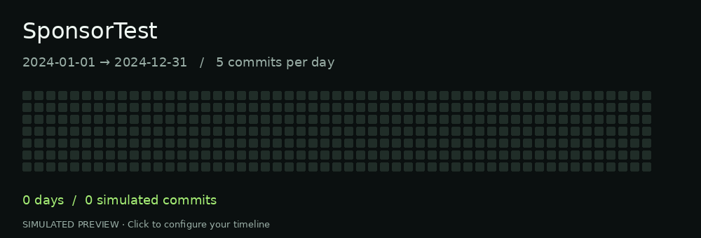

# FREE CONTRIBUTIONS

**Choose your dates. Set your daily commits. Preview an all-green contribution calendar.**

A dependency-free Node.js tool for generating dated Git commits in a repository you own. Configure commits per day and any inclusive date range, including multiple past years. Generated history is clearly labeled as synthetic activity.

[**Try the interactive demo →**](https://brunnojob.github.io/free-contributions/) · [Report an issue](https://github.com/brunnojob/sponsortest/issues)

[](https://brunnojob.github.io/sponsortest/)

## Quick start

Requires **Node.js 22+** and **Git**. No npm install or API token needed.

```sh
git clone https://github.com/brunnojob/sponsortest.git
cd sponsortest
node index.js --start 2024-01-01 --end 2024-12-31 --per-day 5
```

This previews **366 days × 5 = 1,830 commits**, without changing files. To create them, use a separate, clean local Git repository:

```sh
node index.js --start 2024-01-01 --end 2024-12-31 --per-day 5 --repo ../my-history --apply
```

Add `--push` to publish to that repository's `origin` using your existing Git authentication. Set its local `user.name` and `user.email` first. Re-running adds another batch; dates use UTC. This is a one-time generator, so run it again to cover later days.

## Options

| Flag | Purpose |
| --- | --- |
| `--start`, `--end` | Inclusive dates in `YYYY-MM-DD`; 1970 onward, through today |
| `--per-day` | 1–1,000 commits per day; default `5` |
| `--repo` | Separate local repository you own |
| `--apply` | Create commits locally; omitted means preview only |
| `--push` | Push after generation; requires `--apply` |

**GitHub visibility:** commits need an email linked to your GitHub account and an eligible branch in a non-fork repository. Enable private-contribution visibility when using a private repo. Processing can take up to 24 hours; exact green shades are not guaranteed. [GitHub contribution rules](https://docs.github.com/en/account-and-profile/reference/profile-contributions-reference).

The browser demo simulates the calendar, copies a CLI command and exports a JSON plan. It does not access your account or create commits. The GIF links to the interactive version.

## Development

Run `npm test`. Serve `docs/` with any static HTTP server for the demo. GitHub Pages publishes from `main /docs`.

Built by [brunnojob](https://github.com/brunnojob). [ISC license](LICENSE).
